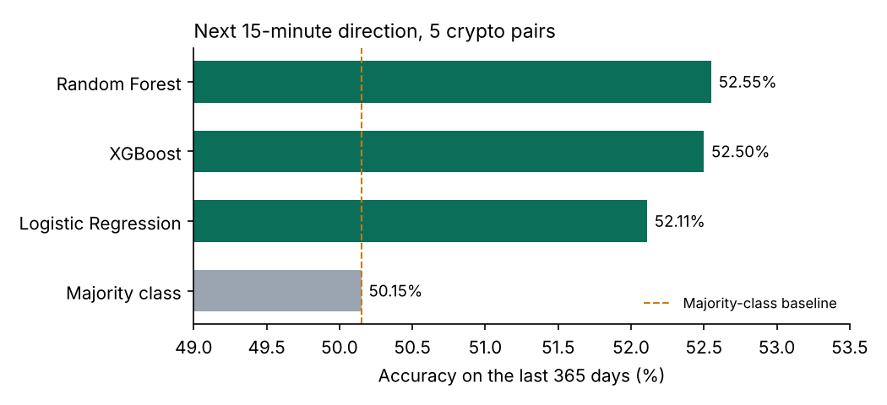

# Crypto Price Direction Prediction


Predicts whether the next 15-minute candle closes **higher or lower** for five crypto pairs on Bybit (BTC, ETH, DOGE, SOL, XRP), using 851,505 candles from March 2020 to January 2026.

The focus is an honest evaluation: a strict time-based split, features that only use past data (checked by tests), and a comparison against a "do nothing clever" baseline.



## Results

Test set: the last 365 days (175,202 candles), never seen during training. 49.8% of test candles go up.

| Model | Accuracy | Balanced accuracy | F1 | ROC-AUC |
|---|---:|---:|---:|---:|
| Random Forest | 52.55% | 52.55% | 0.515 | 0.536 |
| XGBoost | 52.50% | 52.50% | 0.523 | 0.535 |
| Logistic Regression | 52.11% | 52.06% | 0.439 | 0.530 |
| Majority class (baseline) | 50.15% | 50.00% | 0.000 | 0.500 |

**What this means**

- All three models beat the baseline by about 2–2.5 percentage points. On 175,202 test candles that difference is far larger than chance, so the features carry a small but real signal.
- The tree models are only slightly better than logistic regression, so the signal is mostly simple (momentum and volatility), not complex interactions.
- 52.5% is not a trading strategy. Fees, spread and slippage would likely remove an edge this small. The value of the project is the leakage-free method, not the accuracy.

## Method

1. **Data:** 15-minute OHLCV candles per pair, merged into one table, duplicates removed, sorted by pair and time.
2. **Target:** `y = 1` if the next candle closes higher than the current one, otherwise `0`. Computed per pair, so one pair's prices never leak into another's.
3. **Features** (all from the current and earlier candles of the same pair):
   - 15-minute return and volume change
   - 16 lags of each (the last 4 hours)
   - rolling mean and standard deviation of returns over 16 and 64 candles (4 and 16 hours)
   - one-hot pair indicator
4. **Split:** train on everything before the last 365 days, test on the last 365 days. No shuffling.
5. **Models:** majority class, logistic regression (scaled), random forest and XGBoost.

## Tests

`pytest` runs 12 tests on small synthetic candles, so they run in CI without the real data. The most important ones check that:

- changing **future** prices does not change any feature computed earlier (no look-ahead)
- lags never cross from one pair into another
- the train period ends before the test period starts
- the target and the future close are never used as inputs

## Run it

```bash
pip install -r requirements.txt
python -m crypto_direction.run           # full run, writes reports/results.csv (about 15 minutes)
python -m crypto_direction.run --fast    # smaller forests, about 2 minutes
python -m crypto_direction.plot          # redraws reports/accuracy.png

pip install -r requirements-dev.txt
pytest -q
```

## Project structure

```
crypto_direction/
  data.py       load and merge the candle files
  features.py   target and past-only features
  split.py      time-based split and model matrices
  models.py     models and metrics
  run.py        full experiment
  plot.py       results chart
tests/          12 tests on synthetic data
reports/        results.csv and accuracy.png
ML_Project_Bybit_Direction_XGB_RF.ipynb   original exploration notebook
```

## Next steps

- Walk-forward evaluation (several test windows instead of one year)
- Add order-book or funding-rate features
- Estimate whether any edge survives trading fees

Built with Python, pandas, scikit-learn, XGBoost and matplotlib.
